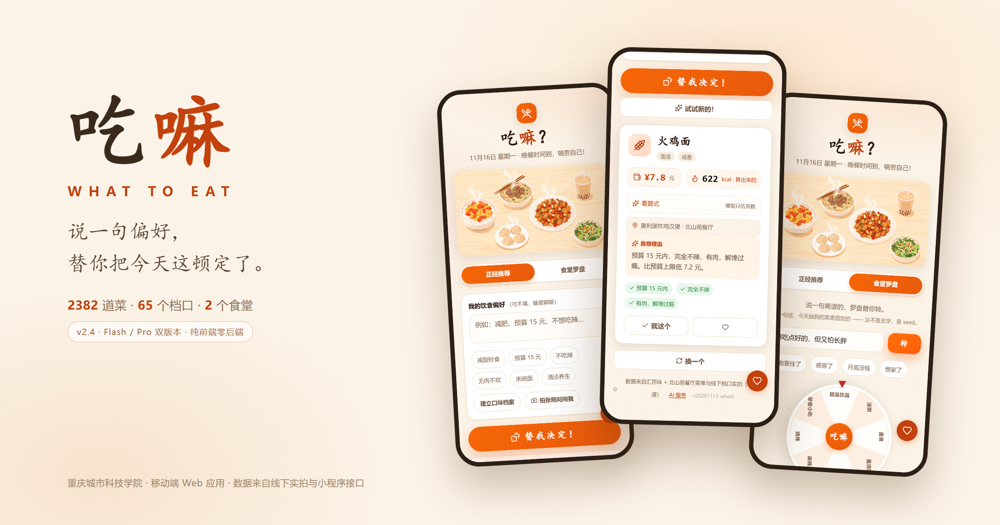
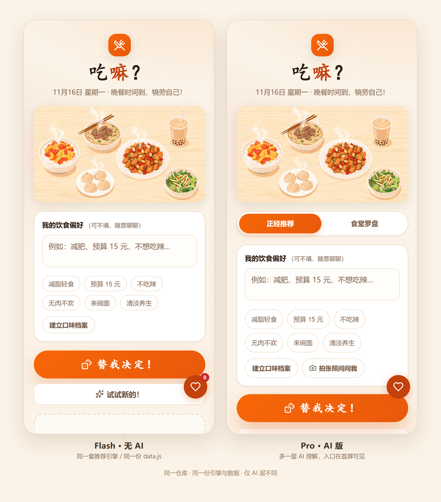
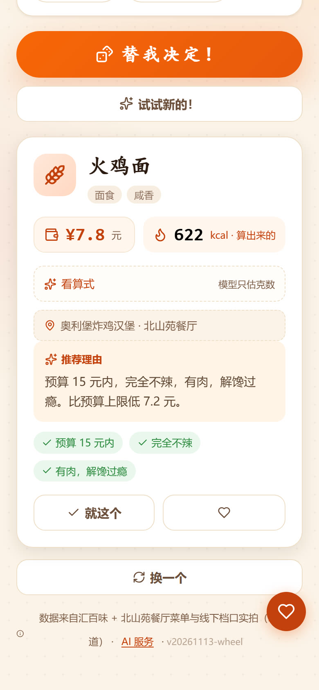
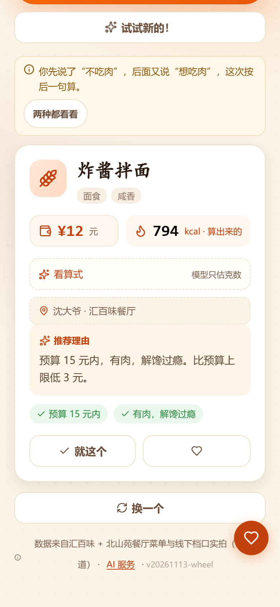
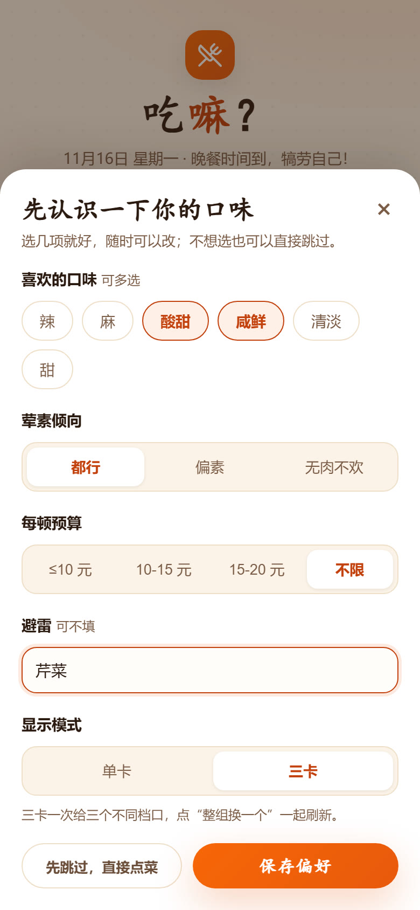
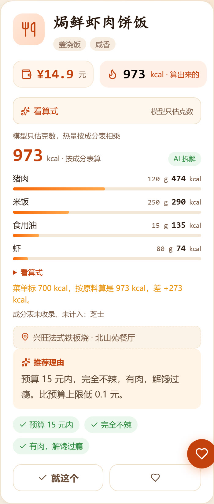
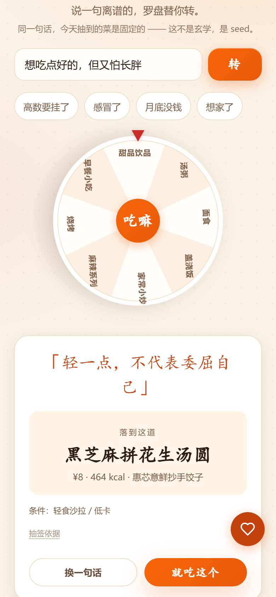

# 吃嘛 · 移动端食堂菜品智能推荐

[](https://github.com/youcheng10d/what-to-eat/actions/workflows/ci.yml)
[](https://github.com/youcheng10d/what-to-eat/actions/workflows/pages.yml)
[](LICENSE)

<p align="center">
  
</p>

**在线体验：<https://youcheng10d.github.io/what-to-eat/>**（手机浏览器打开效果最佳）
**Flash：<https://youcheng10d.github.io/what-to-eat/flash/>**（无 AI，纯规则引擎）
**AI 协作记录：[docs/AI-Collaboration.md](docs/AI-Collaboration.md)**（每次迭代的人机分工、Prompt 与返工记录）

v2.5.0 （传智杯 AI 创新应用挑战赛参赛作品） · What to Eat

> 说一句偏好，替你把“今天吃啥”这顿定了。

“吃嘛”是一款面向大学生的移动端 Web 应用，用来解决每天最烧脑的终极问题——这么多档口和菜，到底吃什么？你写下自己的饮食偏好（例如“减肥、预算 15 元、不想吃辣”），点一下“替我决定！”，它就会从菜品库里筛出一道最合适的菜，并告诉你去哪个食堂、哪个档口。

名字来自初中好友的口头禅“嘛？”——他没听清或没听懂时，就回这一个字，意思是“什么”。

当前版本 v2.5.0：接入 AI，但只让它做「理解」，不做「挑选」也不做「计算」；同一仓库里同时维护 Flash（无 AI）与 Pro（AI 版）两个可运行版本，版本号统一为 v2.5.0。

- **AI 营养拆解**：模型只估算原料与克数，热量由本地《中国食物成分表》逐项相乘求和，算式可展开逐行复核；
- **拍照问诊**：照片 → 可见状态标签 → 硬约束 → 池内推荐，标签用户可改可删；
- **食堂罗盘**：任意荒诞输入 → 签文 + 约束 → 由 `hash(原话 + 日期)` 决定落点，同句同日结果固定；
- **断网可演**：无 AI 服务时自动降级为本地规则估算，界面明确标注来源，不假装是 AI。

推荐池为城科 2382 道 / 65 档口（已清洗掉加菜、配料、串串单串、营销话术，并收敛了 200 条被两个来源重复录入的菜）。

---

## 两个版本

作品只能提交一个仓库，所以两个版本放在同一仓库的两个目录，各自独立部署：

| 版本 | 目录 | 线上地址 | 说明 |
| --- | --- | --- | --- |
| **Flash** v2.5.0 | `what-to-eat/flash/` | <https://youcheng10d.github.io/what-to-eat/flash/> | 无 AI，纯规则引擎；界面停在本轮交互打磨之前 |
| **Pro** v2.5.0 | `what-to-eat/` | <https://youcheng10d.github.io/what-to-eat/> | 同一份引擎与数据 + AI 理解层 + 本轮交互打磨 |



*左边 Flash 没有引擎切换与拍照入口，右边 Pro 多一排“正经推荐 / 食堂罗盘”*

两个版本共用同一个版本号 v2.5.0。版本号一致不代表代码逐行一致：Pro 多 AI 层与本轮交互打磨，Flash 尚未回灌。

两者互不引用：Flash 目录里没有 `ai.js`、没有 AI 入口、没有摄像头调用、没有 Worker 地址。CI 里的 `tests/edition.test.mjs` 会逐项校验，任何一项被污染都会让流水线变红。

**改动顺序**：通用逻辑（推荐引擎、数据、基础样式与交互）先落在 `flash/`，验证通过后再手工移植到 Pro 根目录，并确认 AI 层不受影响。AI 专属功能（罗盘、拍照问诊、营养拆解）只改 Pro。`data/data.js` 两处必须保持逐字节一致，由 `edition.test.mjs` 兜底。

这条顺序目前只执行了一半：本轮交互打磨与罗盘重写直接落在 Pro，Flash 的界面仍是上一轮。回灌 Flash 已列入 Roadmap。Pro 的 AI 层出问题时，可以用 `flash/` 覆盖根目录退回无 AI 版本；`ai.js` 与 `data/ingredients.js` 会留在目录里但不再被引用。

---

## 背景

本项目为传智杯 · 全国高校 Vibe Coding 开发挑战赛参赛作品，对应选题方向 ⑥“校园/垂直社区全栈 MVP 平台”。

形态是纯前端 + 静态数据：零后端、零服务器、零构建工具，数据在构建期由脚本生成，前端只读 JSON。开发全程采用 AI 辅助编程，重点实践意图对齐、架构掌控与可复现演进。

---

## 版本进度

| 版本 | 内容 | 状态 |
| --- | --- | --- |
| v0.1 | 纯前端 MVP，50 道模拟菜品 | 已发布 |
| v1.0 | 接入“学府 e 生活”小程序接口，345 道真实菜品 | 已发布 |
| v1.1 | 线下逐档口拍照 OCR 录入 | 已发布 |
| v1.2 | 剔除商业街、推荐引擎重写，1055 道 / 47 档口 | 已发布 |
| v2.0 | 口味档案、正反馈、单卡与三卡、档口滑窗，1143 道 / 49 档口 | 已发布 |
| v2.1 | 推荐引擎修复：档口分层、面食判定、避雷档口、画像权重 | 已发布 |
| v2.1.1 | 补齐缺失档口与菜品，扩充至 1988 道 / 59 档口 | 已发布 |
| v2.1.2 | 采集脚本重写（两组在营状态 / 分页双保险 / 断点续采），全量重采 3033 道 / 65 档口 | 已发布 |
| v2.2.2 | 采集扩展到文理 e 生活（192 家店 / 8,355 道），城科复采校验脚本稳定性 | 已发布 |
| v2.3.2 | 口味改槽位制，63 组矩阵验收；数据清洗至 2582 道 / 65 档口 | 已发布 |
| v2.4.0 | AI 接入：营养拆解、拍照问诊、食堂罗盘；AI 只做理解不做挑选 | 已发布 |
| v2.4.1 | 称重计价按份换算，id 改内容哈希；2582 → 2382 道，重复收敛 198 组 | 已发布 |
| v2.5.0 | 一份代码两个版本：Flash / Pro 统一 v2.5.0，10 项隔离校验；交互打磨与罗盘重写 | 本文档 |

---

## 核心功能

| 功能 | 说明 | 状态 |
| --- | --- | --- |
| 偏好输入 | 自然语言输入，并提供快捷偏好标签 | 已完成 |
| 硬过滤 | 预算 / 热量 / 忌辣 / 荤素，不满足即出局 | 已完成 |
| 逐级放宽 | 热量 → 荤素 → 预算 → 忌辣，卡片明确提示放宽项 | 已完成 |
| 软打分 | 口味、品类、关键词，仅用于同池内排序 | 已完成 |
| 结果卡片 | 菜名、价格、卡路里估算、推荐理由、档口与食堂 | 已完成 |
| 换一个 | 复用当前偏好并排除已推荐过的菜 | 已完成 |
| 草稿保留 | 偏好存 localStorage，刷新不丢 | 已完成 |
| 口味档案 | 首次使用弹窗，本地存储，不做非黑即白选项 | v2.0 |
| 正反馈 | “就这个”只做正向记录，不因“换一个”扣分 | v2.0 |
| 多卡堆叠 | 单卡与三卡横滑，一组内强制不同档口 | v2.0 |
| 冲突处理 | 条件自相矛盾时实时提示，按后写优先裁决，可“两种都看看” | v2.0 |
| 试试新的 | 按陌生度优先推荐近期未出现过的档口 | v2.0 |
| 口味槽位 | 每张卡先定主角口味，多选口味按轮转分配，欠账制补探索位 | v2.3 |
| AI 营养拆解 | 模型给原料克数，热量由成分表算出，算式可展开 | v2.4 |
| 拍照问诊 | 照片 → 状态标签 → 硬约束，标签可改可删，不做医疗诊断 | v2.4 |
| 食堂罗盘 | 荒诞输入 → 签文 + 约束 → seed 决定落点，与正经引擎分离 | v2.4 |
| 断网降级 | 无 AI 服务时切本地规则估算，界面标注来源，不伪装 | v2.4 |
| 称重计价 | 牌面单价与每份估价分开存，卡片标注“元·估”，预算按份价过滤 | v2.4.1 |
| 版本隔离 | 同一仓库两个可运行版本，10 项校验防止 AI 代码混入 Flash | v2.5 |

## 界面速览

| 首页 | 一键决定 | 冲突处理 |
| --- | --- | --- |
|  |  |  |

| 口味档案 | AI 营养拆解 | 食堂罗盘 |
| --- | --- | --- |
|  |  |  |

---

## 推荐流程

```
① 解析：预算 / 热量 / 忌辣 / 荤素 / 菜名关键词
② 硬过滤：不满足即出局；无解时逐级放宽并提示
③ 软打分：口味、品类、关键词 —— 只负责排序
④ 全池 softmax 抽样（T = 1.5）→ 档口滑窗限频 → 渲染卡片
```

设计原则：硬条件决定“能不能出现”，软偏好决定“谁排前面”。

AI 只接在两端，不进入中间的抽签环节：

```
输入侧：照片 → 可见状态标签 → 标签映射表 → 一句人话写进输入框
输出侧：菜品 → 模型给原料克数 → 本地成分表相乘求和 → 展示算式与差额
```

模型不接触菜品池，也不接触热量计算。所以它既不会编出不存在的菜，也不会让同一道菜出现两个热量值。

---

## 数据来源

- 小程序接口：从“学府 e 生活”（api-order.lcsw.cn）抓取入驻档口菜单，共 5 个档口。脚本为 tools/collect-lcsw.ps1，token 有效期 3 小时，需在本地手动运行
- 线下实拍：逐档口拍菜单照片，多模态 OCR 结构化为 tools/staging/*.json，覆盖汇百味、北山苑两个食堂的 49 个档口
- 清洗合并：tools/build-manual.ps1 清洗 OCR 数据，tools/build-data.ps1 合并两路数据生成 data/data.js
- 已剔除：商业街门店（古茗、古春堂）与便利店，只保留食堂正餐档口

数据只取事实信息——菜名、价格、档口、营业时间——不含用户评论与个人信息。

---

## 数据处理与管线

数据在构建期生成，前端只读一份 JSON；同一份输入重建，结果一致。

```
小程序接口（LCSW） ─┐
                     ├─→ tools/build-data.ps1 → what-to-eat/data/data.js → 前端只读
线下实拍 OCR JSON ───┘
```

构建脚本做四件事：剔除加菜与配料条目、收敛两个来源的重复菜、把「元/50g」的称重单价换算成每份估价、用 `hash(档口|菜名)` 生成稳定 id。每一步都在本地可复跑，不依赖网络。

---

## 技术实现

- 纯静态：HTML + CSS + 原生 JavaScript，零框架、零构建，双击 index.html 即可运行
- 数据层：mock.js 为 50 道模拟数据兜底，data/data.js 为真实菜品数据，前端优先读取后者
- 服务层：api.js 提供 API.recommend({ text, profile, feedback, excludeIds, recentStalls, mode, novelty }) 异步接口，签名与返回结构对齐未来后端
- AI 层：ai.js 是唯一的热量计算入口与 AI 调用闸门，负责缓存、超时、降级与来源标注；data/ingredients.js 是 116 条食材成分表
- 代理层：ai-worker/ 是 Cloudflare Worker，Key 存服务端，前端拿不到；三个端点 /nutrition /portrait /oracle，契约层禁止模型返回热量
- 视图层：app.js 负责状态管理与 DOM 渲染，图标统一使用 Lucide 内联 SVG
- 动效：分组淡入、卡片弹入、加载骨架屏，并适配 prefers-reduced-motion

---

## 目录结构

```
项目一  今天吃啥/
├── README.md
├── docs/
│   ├── AI-Collaboration.md    # AI 协作与 Prompt 链记录
│   ├── api-recon.md           # 小程序接口侦察记录
│   └── blog/                  # 开发日志 01-11
├── ai-worker/
│   ├── index.js               # Cloudflare Worker：营养 / 拍照 / 罗盘
│   └── wrangler.toml
├── tests/                     # 纯 Node 回归测试，无框架依赖
├── tools/
│   ├── collect-lcsw.ps1       # 小程序 API 采集
│   ├── build-manual.ps1       # 线下 OCR 数据清洗
│   ├── build-data.ps1         # 合并两路数据生成 data.js
│   └── staging/               # OCR 结构化中间数据
└── what-to-eat/               # 应用本体
    ├── index.html
    ├── styles.css
    ├── mock.js                # 模拟数据（兜底）
    ├── data/data.js           # 真实菜品数据
    ├── data/ingredients.js    # 食材成分表（热量计算的唯一依据）
    ├── ai.js                  # AI 胶水层：缓存 / 超时 / 降级 / 来源标注
    ├── api.js                 # 推荐服务层
    ├── app.js                 # 状态管理与渲染
    ├── flash/                 # Flash 版（无 AI），与根目录共用 data/data.js
    └── assets/
```

---

## 10 分钟极速复现

### 1. 跑起来（1 分钟，零依赖）

直接双击打开 `what-to-eat/index.html` 即可，无需安装环境或依赖。

如需以本地服务器方式预览：

```bash
cd what-to-eat
python -m http.server 8080
# 浏览器访问 http://localhost:8080
```

此时全部功能可用，AI 部分会自动走**本地降级**，界面上标「本地估算」。

### 2. 接上 AI（3 分钟，可选）

```bash
cd ai-worker
npm i -g wrangler
wrangler login
wrangler secret put AI_KEY        # 默认接硅基流动；换服务商只改 wrangler.toml 前三行
wrangler deploy
```

拿到 `https://<name>.<account>.workers.dev` 后，打开应用 → 页脚「AI 服务」→ 填入地址 → 测试连接。

拍照用的是同一把 Key 下的视觉模型（默认 `Qwen/Qwen3-VL-8B-Instruct`）。要换模型，改 `wrangler.toml` 里的 `VISION_BASE` / `VISION_MODEL`；`VISION_KEY` 留空时回落到 `AI_KEY`。`VISION_MODEL` 留空则 `/portrait` 返回 502，前端自动隐藏拍照入口。

**环境变量模板**

| 变量 | 位置 | 说明 |
| --- | --- | --- |
| `AI_BASE` | wrangler.toml `[vars]` | 默认 `https://api.siliconflow.cn/v1` |
| `TEXT_MODEL` | wrangler.toml `[vars]` | 默认 `zai-org/GLM-5.3-Flash` |
| `NUTRITION_MODEL` | wrangler.toml `[vars]` | 营养拆解专用，默认 `Qwen/Qwen3.6-35B-A3B` |
| `VISION_BASE` | wrangler.toml `[vars]` | 默认同 `AI_BASE` |
| `VISION_MODEL` | wrangler.toml `[vars]` | 默认 `Qwen/Qwen3-VL-8B-Instruct` |
| `AI_KEY` | secret | 文本与营养模型 key |
| `VISION_KEY` | secret | 视觉模型 key，留空回落到 `AI_KEY` |

### 3. 跑回归（2 分钟）

```bash
node tests/smoke.test.mjs
node tests/recommend.test.mjs
node tests/integration.test.mjs
node tests/golden.test.mjs
node tests/flavor-matrix.mjs
```

纯 Node 脚本，无测试框架依赖。最后一条会跑 63 组口味组合矩阵，约 30 秒。

### 4. 重建数据（可选，需要 PowerShell）

```bash
powershell -File tools/build-data.ps1
```

同一份输入会生成同一份 `data/data.js`，构建过程无网络请求。

### 5. 验证 AI 契约（可选）

```bash
curl https://<your-worker>/health
# {"ok":true,"text":true,"vision":false}
```

`text` / `vision` 如实反映是否配好，没配就是 `false`，不会假装成功。

---

## Roadmap

v2.0：

- [x] 首次使用口味档案（localStorage 本地存储）
- [x] “就这个”正反馈记录
- [x] 单卡与三卡横滑，档口滑窗限频
- [x] “试试新的！”按陌生度排序
- [x] 依据 27 份问卷结论校准软打分权重

v2.4 已完成：

- [x] AI 营养拆解：模型给克数，成分表算热量，算式可展开
- [x] 拍照问诊：照片 → 标签 → 约束，标签可改可删
- [x] 食堂罗盘：荒诞输入 → 签文 → seed 决定落点，与正经引擎分离
- [x] 断网降级：无 AI 服务时标「本地估算」，不伪装
- [x] 称重计价菜品按份换算，修正 ¥1.98 这类单价展示
- [x] 重复收敛与内容哈希 id，重建不再漂移

v2.5 已完成：

- [x] Flash / Pro 同仓库分目录，10 项隔离校验守住边界
- [x] 交互打磨：焦点陷阱、引擎切换过渡、收藏撤销、三卡圆点
- [x] 罗盘两段式转动，落点词回正，首屏位移降到 0.0004

v2.5 之后：

- [ ] 通用交互回灌 Flash，两端界面对齐
- [ ] 采集脚本通用化，支持 LCSW 平台的其他高校
- [ ] 定位与“校内吃 / 校外吃”切换
- [ ] 推荐结果分享、历史记录
- [ ] 移动到主屏（PWA）

---

## 数据说明

菜品与价格来自线下实拍与小程序入驻档口接口，可能随档口调整而变化。

热量分两层：卡片上的 `cal` 是采集时的品类估算值；「AI 拆解」展示的是按原料克数现算的值，两者会并列显示差额。AI 拆解的克数由模型估算，热量由本地成分表计算，属于**估算**，不是实验室测定，不构成营养或医疗建议。

称重计价菜品（麻辣烫 1.98 元/50g、自选健康餐 1.78 元/50g）在构建期被识别并换算：`price` 存按 400g 估的每份价，用于预算过滤；`unitPrice` 存牌面单价，卡片上两者并列显示，并注明“实际以称重结算”。识别规则见 `tools/build-data.ps1` 第 6.95 步（称重计价）。

---

## 开发记录

开发日志系列（docs/blog/）：

- [01 · v0.1：从一句 Prompt 到第一个上线项目](docs/blog/blog-01-v0.1.md)
- [02 · v1.0：从 50 道模拟菜到 345 道真实菜品](docs/blog/blog-02-v1.0.md)
- [03 · v1.2：推荐引擎重写，以及一个名字的由来](docs/blog/blog-03-v1.2.md)
- [04 · v2.0：27 份问卷，和一次按答案做的换代](docs/blog/blog-04-v2.0.md)
- [05 · v2.1：一句“不吃面”，和它的三层防线](docs/blog/blog-05-v2.1.md)
- [06 · v2.1.2：一次数据补采，和四个旧账](docs/blog/blog-06-v2.1.2.md)
- [07 · v2.2.2：学府e生活菜单采集：一次跨校实验](docs/blog/blog-07-wenli.md)
- [08 · v2.3.2：口味改成槽位，和一千二百六十张卡的验收](docs/blog/blog-08-v2.3.2.md)
- [09 · v2.4.0：AI 只做理解，不做挑选，也不做计算](docs/blog/blog-09-v2.4.0.md)
- [10 · v2.4.1：一块九的麻辣烫，和会漂的 id](docs/blog/blog-10-v2.4.1.md)
- [11 · v2.5.0：一份代码，两个版本](docs/blog/blog-11-v2.5.0.md)
