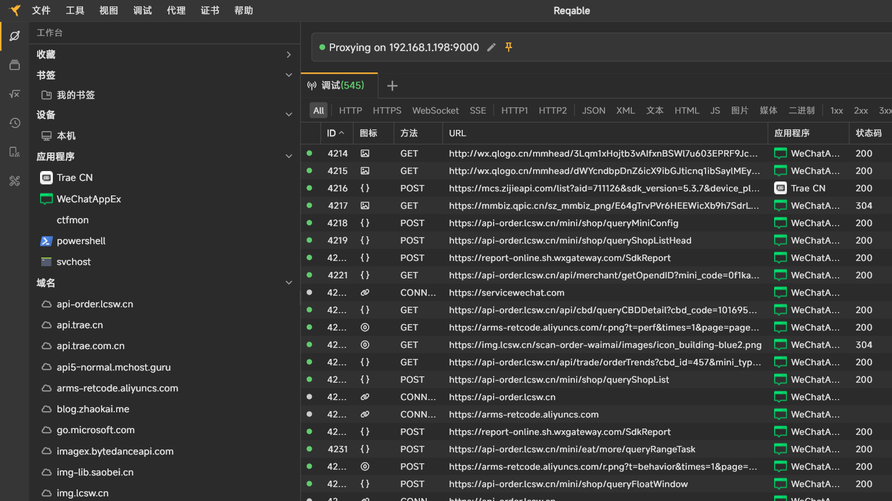
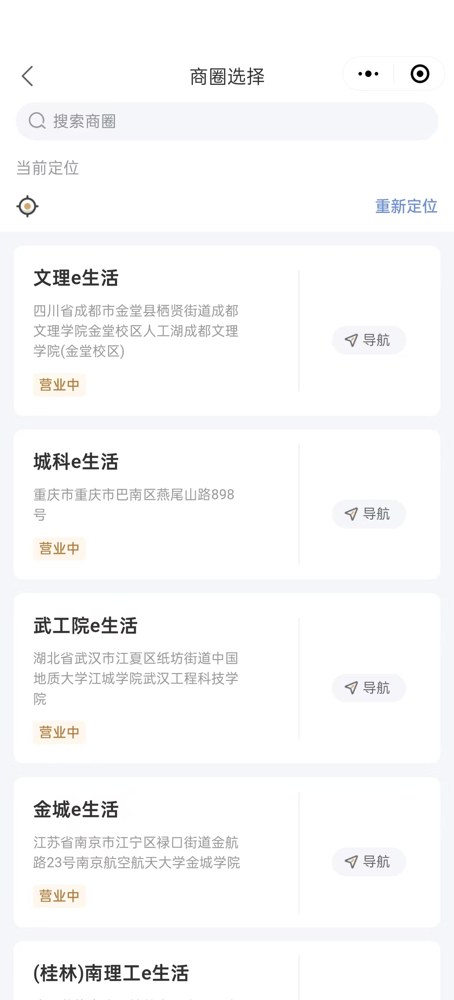
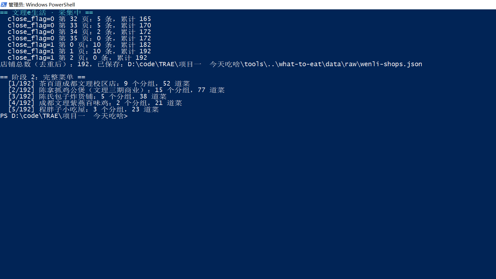
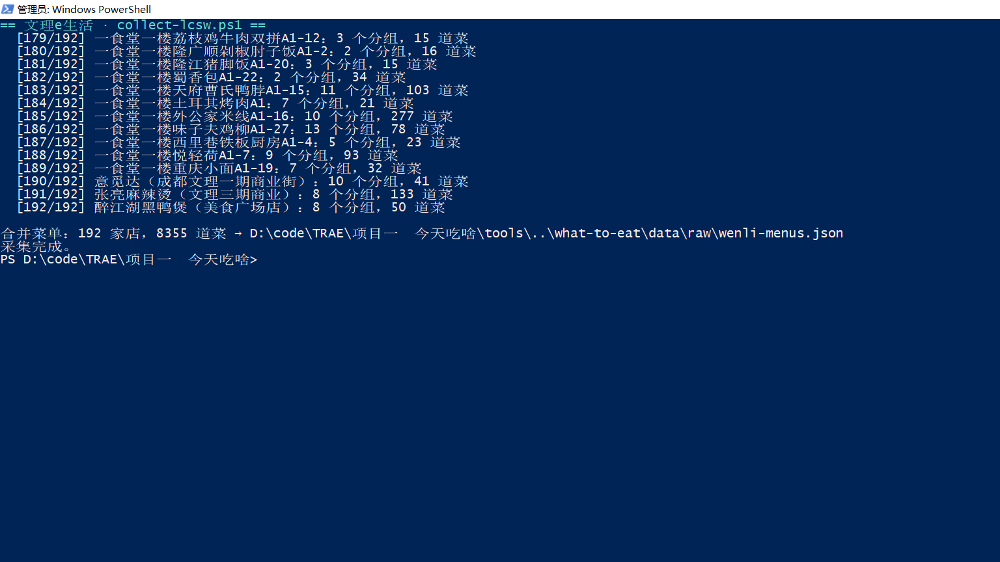
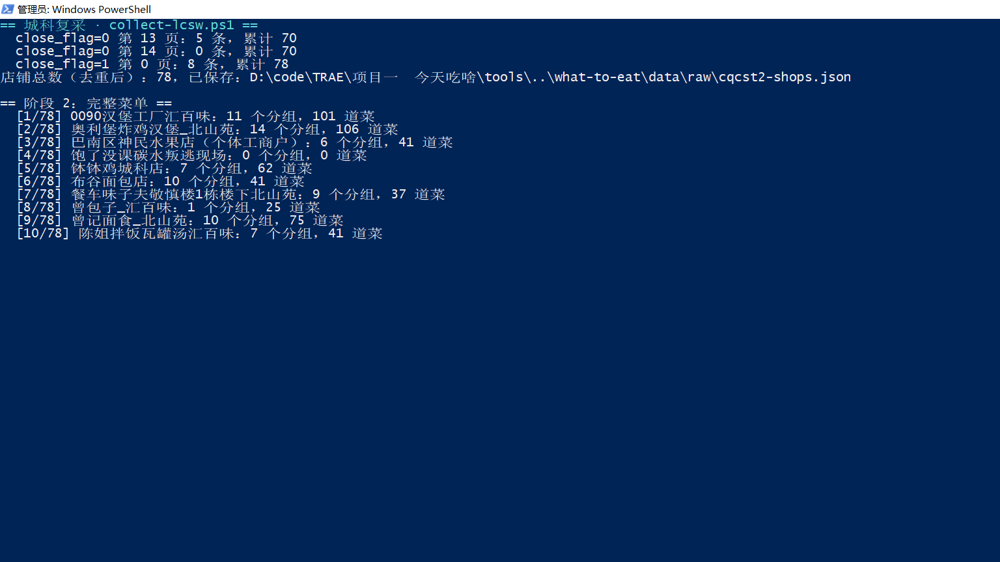

# 吃嘛 · 开发日志 07 ⭐ 学府e生活菜单采集：一次跨校实验
> ***v2.2.2*** ｜ 采集日期：2026 年 11 月 5 日。工具：Windows 电脑微信、Reqable（mcp-server 1.0.1）、Trae CN、PowerShell 5.1。只采集档口名、菜品名、价格与分组，不含评论。

用 Reqable MCP 读完文理 e 生活的 192 家店铺、8,355 道菜，再回头复采城科做对照。

---
## [1. 先给结论](#1)
• 同一份脚本、同一个 token，只改 `area_code`，从城科（78 家店）扩到文理（192 家店）。  
• 文理：**192 家店、8,355 道菜、0 错误、0 次 401**，耗时约 27 分钟。  
• 城科复采：**78 家店、4,324 道菜、0 错误**，与上次的 78 家、4,345 道基本对齐，差在 11 家店的菜单本身变了。  
• 学校不是独立 App，而是同一个 SaaS 下的一个个商圈。**token 认人，不认学校**。  

---
## [2. 把 Reqable 接成 MCP](#2)
上一轮的 token 是从 Reqable 进程内存里捞出来的，能用，但不体面。这次换正门：Reqable 安装包里自带 `mcp-server.exe`，以 stdio 方式注册进 Trae CN 的 `mcp.json`，AI 就能直接读抓包记录。

先摸工具清单。`capture_live_filter` 的过滤器是 `oneOf`，一共七种形状：

| 类型 | 字段 | 用途 |
|---|---|---|
| `keyword` | `pattern` / `regex` / `caseSensitive` | 全字段搜关键字 |
| `url` | `urls[]` | 精确匹配整条 URL |
| `host` | `hosts[]` | 精确匹配域名 |
| `ip` | `ips[]` | 远端 IP |
| `method` | `methods[]` | 请求方法 |
| `code` | `codes[]` | 响应状态码 |
| `application` | `name` / `id` / `pid` | 客户端进程 |

这份 schema 官方文档没写。我按直觉试了三次 `{"type":"url","value":"lcsw.cn"}`、`{"type":"url","pattern":"lcsw.cn"}`、`{"type":"domain","value":"lcsw.cn"}`，全部报 `Value matches 0 schemas`。最后直接从 `mcp-server.exe` 里读出 schema 才通：`url` 只收精确 URL 数组，模糊匹配得用 `keyword`。

顺便发现 Reqable 还开着一个本地 HTTP 服务（`127.0.0.1:9016`），`/capture/live/status`、`/capture/live/filter`、`/capture/live/get` 都在。57 条记录一次性批量拉完，比逐条调 MCP 快得多。



*图 1：域名栏里 api-order.lcsw.cn 排在第一位，应用一栏几乎全是 WeChatAppEx*

一个小坑：`keyword` 会把 Trae 自己的遥测日志也搜出来，因为这份对话里恰好写了 `queryShopList`。不是过滤器坏了，是搜索范围真的覆盖请求体。**用关键字过滤，噪音来自你自己。**

---
## [3. 商圈选择页告诉我的事](#3)
在小程序里点开“商圈选择”，看到的是一张列表：文理 e 生活、城科 e 生活、武工院 e 生活、金城 e 生活、（桂林）南理工 e 生活，每家都带地址和“营业中”。



*图 2：一个 App 下挂着五所学校，选商圈就是选学校*

这条信息比任何接口文档都直接。Appid 只有一个（`wx5b480af3c73f466f`），学校之间靠 `area_code` 区分，登录态是人的，不是学校的。也就是说，**换学校不用换 token**——这件事想通之后，整个多校方案的骨架就立住了。


*图 3：文理 e 生活的店铺列表，三食堂一楼南充米粉、后山驿站代取都在里面*
> 学校不是 App，是商圈；token 认人，不认学校。

---
## [4. 三个参数，一次探针](#4)
从 57 条 `api-order.lcsw.cn` 的记录里抽出关键请求，拿到三件事：

• `Authorization`：JWT，`exp - iat = 10800`，三小时  
• `OpenID`：和城科那次是同一个账号  
• 文理的 `area_code = 10168503`，`cbd_id = 435`  

第四个发现有点意外：小程序自己发的是 `longitude: 0, latitude: 0`。定位不是必需的，商圈已经确定了学校，坐标只影响“离我多远”的排序。城科那次填真实坐标属于多余动作。

探针结果：

| close_flag | 每页条数 | 结束信号 |
|---|---|---|
| 0（在营） | 5 | 第 34 页 2 条，第 35 页空 |
| 1（休业） | 10 | 第 2 页空，`is_last_page=1` |

两组页大小还不一样。上一版“每页 5 条”的假设，只对 `close_flag=0` 成立。

---
## [5. 先一家店，再 192 家](#5)
跑全量之前，先拿第一家店试菜单接口：

```
groups=10  推荐 / 特色拌面 / 2元炸串区 / 冬季无可乐套餐 / 特色汉堡 ...
goods=20   is_last=0
德州拌面+汉堡套餐1  ¥18.8
```

顺手把上一轮没验证的事补了：`eat_type=1` 和 `eat_type=2` 返回完全一致的菜单。堂食和外卖在这套接口下是同一份数据，不用分开采。

确认无误，开跑：



*图 4：逐店翻页，每家店立刻落一个断点文件，401 直接停、普通失败重试三次*



*图 5：192 家店跑完，8,355 道菜，0 错误*

| 原始采集结果 | 文理 | 城科（复采） |
|---|---|---|
| 去重店铺 | 192 家 | 78 家 |
| 菜品记录 | 8,355 条 | 4,324 条 |
| 错误 / 401 | 0 / 0 | 0 / 0 |
| 耗时 | 约 27 分钟 | 约 16 分钟 |

食堂归属按店名归并：三食堂 54、二食堂 49、一食堂 41、商业街 17、美食广场 6、其他 25。

---
## [6. 回头复采城科](#6)
采完文理心里有点飘，怕是自己脚本哪里“凑巧”对了。于是把城科原样再跑一遍，参数不动。



*图 6：城科复采，78 家店，分组和菜品逐店重走*

结果：78 家店，4,324 道菜，0 错误。和上一版 78 家、4,345 道对得上，差的 21 道分散在 11 家店：

| 店铺 | 上次 | 本次 | 差值 |
|---|---|---|---|
| 蜜雪冰城 | 48 | 13 | -35 |
| 布谷面包店 | 32 | 41 | +9 |
| 鸭王鲜拌城科店 | 52 | 56 | +4 |
| 其余 8 家 | — | — | ±1～2 |

蜜雪冰城掉得最狠，一开始以为是分页漏采。查了两边的分组列表：上次 12 个分组（含经典厚奶茶、新鲜冰淇淋、雪王咖啡、轻乳系列），这次只剩 6 个。**分组列表本身就是一次请求返回的，不是翻页拼出来的**，所以这是菜单真的下线了，不是脚本少翻了页。

复采的意义就在这儿：同一天跑两所学校，再把城科重跑一次，采集链路的行为才敢说“稳定”。
> 分组列表一次返回，翻页翻不出没有的东西。

---
## [7. 还差什么](#7)
采集通了，不代表“适用所有学校”通了。真正卡住的是后半段：

• `build-data.ps1` 的输入路径写死 `cqcst-*.json`，食堂白名单只认汇百味 / 北山苑，楼层映射也按这两栋楼写。  
• 文理的食堂叫一食堂 / 二食堂 / 三食堂，还混着美食广场和商业街，白名单会把它们整批过滤掉。  
• 前端 `data.js` 是单校单库，没有学校选择。  

另外两个数据问题也在这轮暴露：`close_flag=1` 的休业店文理有 20 家；还有“后山驿站代取”这种根本不是餐饮的店铺，采回来 5 道菜，得在清洗层排掉。

至于“任意学校开箱即用”差的那一环——**学校发现**——只解决了一半。文理的 `area_code` 是从 `queryShopList` 里反推的；商圈列表本身的请求还没抓到，那次点击发生在抓包开启之前。商圈选择页上那五所学校证明接口存在，只是还没被记录。
> 采得到和用得上之间，隔着一条写死学校名的管线。

---
## [8. 写在最后](#8)
*"1% 的灵感，加上 99% 的执行力。"*

这一篇的 1%，是那个判断：学校不是一个 App，而是同一个 SaaS 下的一个商圈。想通这一层，采集脚本才敢只改一个 `area_code` 就去跑第二所学校；想不通，就会去注册第二个小程序、再要一份登录态。

99% 的执行力，是把抓包记录变成可查询的数据（七种过滤器、57 条记录、一次批量读取），是先探针、再单店、后全量的三步验证，也是回头把城科原样复采一遍、逐店对齐 78 家店的差异。

脚本没改一行，接口没变一个，token 也没换。剩下的工作是参数化：把食堂白名单、路径和楼层映射从“城科”里拆出来。

---
上一篇：[v2.1.2 · 一次数据补采，和四个旧账](blog-06-v2.1.2.md) ｜ 下一篇：（待发布）
