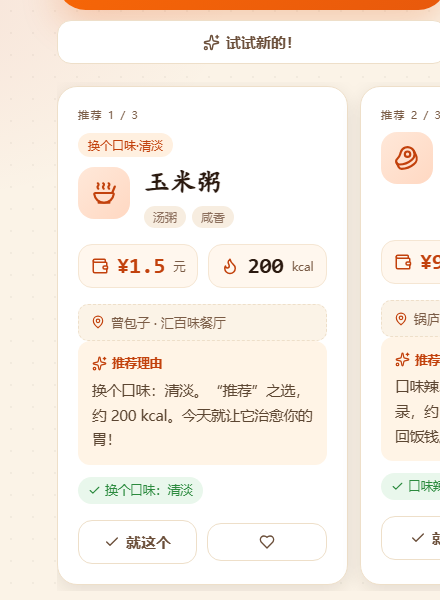
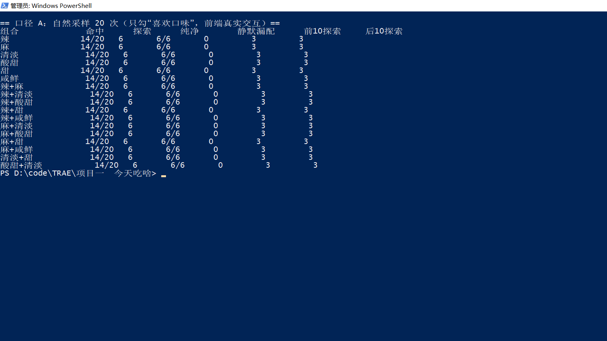

# 吃嘛 · 开发日志 08 ⭐ 口味改成槽位，和一千二百六十张卡的验收
> ***v2.3.2*** ｜ 一份两元的番茄，六十三组口味搭配。

项目英文名 What to Eat（仓库 what-to-eat，下文简称 wte），中文名“吃嘛”。本文是开发日志第八篇，记录一次验收：用 63 组搭配、1260 张卡，去回答上一版改的到底有没有用。

---
## 两元的番茄
勾了“酸甜”，推出来一份 2 元的番茄。

往回倒：番茄 2 元，原始分组叫“口味必选”，名字里带“茄”被归进家常小炒，再推断出口味“酸甜”。勾了酸甜加 5 分，它成了那个档口的最高分菜；档口分层先按最高分选出档口，再在档内抽到它。每一步单看都成立，终点是一份生番茄。

按分组黑名单清一遍：加菜、加料、必选、锅底、蘸料、餐具、点餐前、辣度、味型、单点……命中 332 道，占全库 11%，集中在麻辣烫 80/100、香灶火锅冒菜 72/96、今喜炸串 49/103、欧氏重庆鸡公煲 48/86。

自选称重档口不能整档删，删了就没得吃。改成折叠：档口名匹配“麻辣烫、冒菜、炸串”，加菜占比过半、加菜数不少于 8 道时，整档折成一条虚拟菜，得到自选麻辣烫 ¥16.8、自选冒菜 ¥13、自选炸串 ¥10，价格取真菜中位价。档口数仍是 65。

手工补录的 884 道和 845 道绕过了分组过滤，残留“小吃单点”“★加醋”这类条目，构建脚本末尾又加了一道终检。

还有个更隐形的问题：68.2% 的菜一个口味标签都没有。没标签就没资格参与口味打分——勾了酸甜，全库只有三成菜能进来。按品类补默认值后缺失降到 0，但咸鲜兜底吃掉了 75.7%。

3033 道变成 2670 道。
> 一条链路上每一步都对，不代表终点对。

---
## 口味从加分项变成槽位
旧实现里口味是加分项：命中几个加几个 5 分，封顶 12 分。单口味勉强能用，多口味直接失效——勾 4 个，命中 1 个和命中 4 个的差距压不过档口和品类那几层权重，约束等于不存在。

v2.3 换成槽位：每张卡先定一个主角口味，打分只认这个口味。三卡模式按已选口味轮转，卡与卡的主角互不相同；单口味时三张同口味，只留一张探索位。

留出换口味空间的是欠账制：

| 常量 | 值 | 作用 |
| --- | --- | --- |
| `EXPLORE_WINDOW` | 10 | 统计最近 10 张卡 |
| `EXPLORE_MIN` | 3 | 每 10 张至少 3 张换口味 |
| `STRONG_MAX` | 1 | 强反差每 10 张最多 1 张 |

口味分三个味系：辣↔麻、酸甜↔甜、咸鲜↔清淡。换口味优先同味系，34% 概率跨味系来一次强反差；轮转按“最久没出现”排。前端把主角口味记进 `wte.flavorHistory`，只留 10 条回传。

*图 1：第一张卡是探索位，标签写着“换个口味·清淡”*

---
## 六十三组，不是二十一组
一开始按 6+5+4+3+2+1=21 组设计。写到一半发现算错：取 2 个口味是 C(6,2)=15 种，不是 5 种。真实搭配数是 63 组。

| 已选口味数 | 1 | 2 | 3 | 4 | 5 | 6 | 合计 |
| --- | --- | --- | --- | --- | --- | --- | --- |
| 组合数 | 6 | 15 | 20 | 15 | 6 | 1 | 63 |

每组跑两个口径。自然采样 20 次，只勾“喜欢口味”，看命中、探索位、探索位是否真的不含已选口味，63 组共 1260 张卡。输入框否定 12 次，6 次正向、6 次“不想吃 X”，共 756 次调用。

脚本固定 seed = 20261109，用线性同余替换 `Math.random`，跑两次结果逐张一致。

*图 2：口径 A 的前 17 行，命中 14/20、探索 6、纯净 6/6*

---
## 探索卡有一半没换干净
第一轮跑完，命中率 82.2%、探索率 27.6%，看着都对。把探索卡单独拎出来：348 张里 124 张仍含已选口味，纯净度只有 64.4%。

勾“辣”，探索槽选“麻”，推出来是“黄金鸡柳（藤椒味）”“麻辣牛肉”，全是辣麻双标签菜。用户看到“换个口味·麻”，吃到嘴里还是辣。

原因在打分：探索槽只给 +12 分，不做排除，双标签菜靠这 12 分就能压过纯“麻”的菜。

改成候选池先排掉带已选口味的菜，池子不够才回退；探索目标必须至少有一道纯净菜，否则这次不探索。改完 366 张探索卡全部干净，命中率 82.2% → 71.0%，探索率 27.6% → 29.0%——两者互补，71.0 + 29.0 = 100；改之前有 124 张既算命中又算探索。
> 加权能表达偏好，表达不了排斥；“换”只能靠排除实现。

---
## 味系被勾满，探索就停了
反直觉的失败：勾“辣 + 麻”，探索率只有 10%。

因为同味系优先。辣和麻同属辛辣味系，都被勾走后同味系没有温和候选，只剩 34% 的强反差，20 张里出 2 张。六组“味系占满”的搭配全是这个症状。

改法是味系占满时直接跨味系，且不占那 1/10 的配额。

跨味系也不能乱跨。查数据发现：“麻”有 155 道菜，却没有一道单口味菜——136 道“辣+麻”，18 道“辣+麻+咸鲜”，1 道“辣+麻+甜”，全部带着辣。勾了辣再拿“麻”当目标，必然找不到纯净菜，白占一半配额。

于是探索候选再加一条：当前池子里得有它的纯净菜。六组从 2/20 恢复到 6/20。
> 一个永远和别的口味绑在一起的口味，不能单独拿来当探索目标。

---
## 三条旧账
否定那组的违例 32 次全是“辣”，查下去是三条独立的错。

1、辣度只看 `spicy` 字段。库里 478 道标签带辣，其中 73 道 `spicy` 是 0——椒麻抄手、藤椒渔粉。“不能吃辣”对它们完全无效。改成 `spicy > 0` 或标签含辣。  
2、“不想吃清淡”被读成想吃清淡。正向检测跑在原句上，还顺手把 `maxCal` 设成 600，卡上写着“已放宽低卡要求”。改成只在未被否定的片段上匹配。  
3、口味避雷是全有或全无。口味词塞进普通忌口，池子空了就整体丢弃、回落全库随机；而放宽顺序里忌辣排在忌口前面，辣菜最先回流。

改成独立的 `avoidFlavors`，按违例口味数 0 → 1 → 2 逐级放宽，避开 4 个以上时选违例最少的菜。最终 96.8%，剩下 12 次里 9 次是咸鲜——2021/2670 道菜都标了咸鲜，禁掉之后池子本来就所剩无几。

*图 3：命中 70.4%、避开 96.8%，违例 12 次里 9 次是咸鲜*

---
## 一条断言又改了阈值
集成测试里写着“任意 10 张至少 3 张换口味”，这轮红了，最少只出 2 张。

不打算改引擎：三卡模式单次请求只发一张探索卡，连续 10 张只跨约 3.3 次请求，30% 的目标下期望 3 张，短窗口下限必然是 2。旧实现能过，是那一次的窗口恰好凑够 3 张。

断言拆成两句：短窗口守“至少 2 张”，整体守“25%–35%”。

变异测试也跟着动。原来 M5 只断 `spicy > 0` 一处，现在辣度有三条通道——`spicy` 字段、口味标签、口味避雷——三条全断才算真不忌辣。改完 10 个变异体全部杀死。
> 断言在旧实现上偶然能过，不代表它是对的。

---
## v2.3.2 的诚实局限
• 6 个口味全禁，违例率必然 100%——每道菜至少带一个标签；5 个口味时探索率 25%，只剩一个可选口味且不一定有纯净菜。  
• 标签按品类默认值补，咸鲜兜底 75.7%，这个分布本身不合理。  
• 口味是从菜名和品类推的，不是菜单原文的味型字段；按“辣度”分的必选分组被当加菜清掉，微辣、中辣、特辣没有保留。  
• 自然采样只测单卡，三卡模式的多样性与主角互异靠集成测试覆盖。  
• `tests/flavor-matrix.mjs` 还是脚本形态，只打印不判错，没进 CI。

---
## 下一篇
下一步不在推荐逻辑里，在数据里：把口味标签从品类默认值换成真正的味型标注，先让咸鲜的 75.7% 降下来；再把 `flavor-matrix.mjs` 改成能判错的测试，接进 CI。

---
## 写在最后
*"1% 的灵感，加上 99% 的执行力。"*

这一篇的 1%，是那句“加权表达不了排斥”。想通之前，探索槽一直在加分；想通之后才知道，“换个口味”只能靠排除实现——一道菜可以同时是辣的又是麻的。

99% 的执行力，是把 63 组搭配跑成 1260 张卡，是发现“麻”没有一道单口味菜这种必须翻数据才能看见的事实，是把辣度从一条通道补成三条，也是又一次承认自己写的断言不成立、把它拆成短窗口和整体两条。

---
上一篇：[v2.2.2 · 学府e生活菜单采集：一次跨校实验](blog-07-wenli.md) ｜ 下一篇：（待发布）
