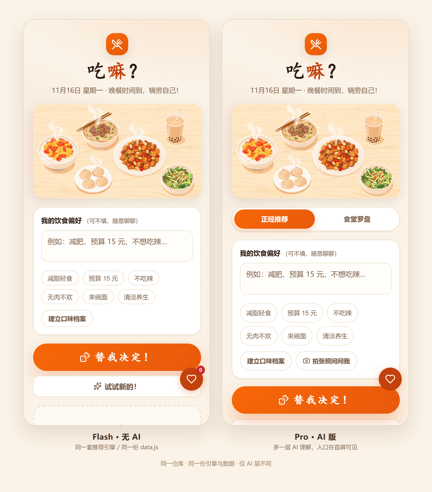
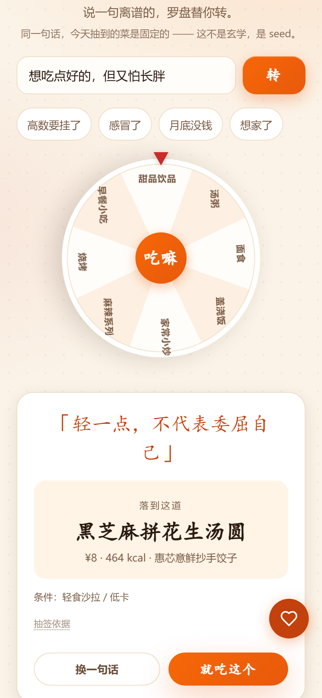

# 吃嘛 · 开发日志 11 ⭐ 一份代码，两个版本
> ***v2.5.0*** ｜ Flash 630 行，Pro 1610 行；十条隔离校验；罗盘首屏位移 0.0004。

比赛只能提交一个仓库。但同一份作品，要能回答两个问题：有 AI 是什么样，没有 AI 又是什么样。

本文记两件事：怎么把两个版本装进一个仓库而不互相污染，以及罗盘上那些被甩歪的字。

---
## 先给结论
• 两个版本放在同一仓库的两个目录：`what-to-eat/`（Pro，AI 版）与 `what-to-eat/flash/`（Flash，无 AI）。  
• 线上地址分别是 `/what-to-eat/` 与 `/what-to-eat/flash/`，页面内全部使用相对路径，重命名目录不会断链。  
• `tests/edition.test.mjs` 十条检查守住边界：Flash 里没有 `ai.js`、没有 AI 入口、没有摄像头调用、没有 Worker 地址。  
• 两边的 `data/data.js` 必须逐字节一致，由同一条用例兜底；任何一边改了数据，另一边不跟上，CI 就红。  
• 通用逻辑先改 Flash，验证通过再手工移植 Pro；AI 专属功能只改 Pro。  
• 这一轮是例外：交互打磨与罗盘重写只落在 Pro，Flash 的界面仍停在上一轮，这笔账留到下一篇之后还。  

---
## 两个仓库，还是一份代码
最早试过拆成两个 GitHub 仓库：一个纯前端，一个接 AI。好处是边界物理隔离，坏处很快出现：

| 问题 | 两个仓库 | 一个仓库两个目录 |
| --- | --- | --- |
| 提交入口 | 两个，容易漏提交 | 一个 |
| 数据文件 | 两份，靠人记得同步 | 两份，靠测试强制一致 |
| 历史记录 | 两条，版本号对不齐 | 一条 |
| 比赛提交 | 只能选一个 | 直接交 |

作品只能提交一个仓库，所以最终收回到单仓库。两个版本不是两份代码，而是同一条代码边界的两侧：Flash 是 Pro 去掉 AI 层之后的结果。

目录长这样：

```
what-to-eat/
├── index.html          # Pro 入口
├── ai.js               # AI 胶水层，只有 Pro 有
├── data/ingredients.js # 成分表，只有 Pro 有
├── app.js              # 1610 行
├── styles.css          # 1097 行
└── flash/
    ├── index.html      # Flash 入口
    ├── app.js          # 630 行
    └── styles.css      # 596 行
```

目录原来叫 `standard/`。后来发现“普通版”这个叫法在文档里指代不清——到底是没有 AI，还是功能更少？统一改成 Flash：快、轻、不依赖网络。Pro 就是带 AI 的那一份。
> 两个版本不是两份代码，是一条边界。

---
## 两个版本差在哪
把两个 `app.js` 放在一起，差 980 行。差的不是功能列表，是三件事：AI 调用、罗盘、以及围绕罗盘的交互。

| 项目 | Flash | Pro |
| --- | --- | --- |
| 版本 | v2.5.0 | v2.5.0 |
| 线上路径 | `/what-to-eat/flash/` | `/what-to-eat/` |
| `app.js` | 630 行 | 1610 行 |
| `styles.css` | 596 行 | 1097 行 |
| `ai.js` | 无 | 403 行 |
| 引擎切换 | 无 | 正经推荐 / 食堂罗盘 |
| 拍照入口 | 无 | 有，未配视觉模型时自动隐藏 |
| 热量展示 | 数据里的品类值 | 成分表估算 + AI 拆解 |
| 界面打磨 | 上一轮 | 本轮：焦点陷阱、圆点页码、罗盘 |



*图 1：左边 Flash 首屏没有引擎切换与拍照入口，右边 Pro 多出一排“正经推荐 / 食堂罗盘”*

首屏的差别只有两处：Pro 多一排引擎切换，多一个“拍照问问我”。剩下的推荐卡、价格、档口、理由，两边是同一套引擎与同一份数据。

这也是为什么边界必须用测试守住——肉眼看，两个版本太像了。

---
## 十条红线
`tests/edition.test.mjs` 只做一件事：证明 Flash 里没有 AI。十条检查：

| 编号 | 检查 | 失败意味着 |
| --- | --- | --- |
| 1 | Flash 快照目录存在 | 目录被删或改名 |
| 2 | 不含 `ai.js` | AI 胶水层混入 |
| 3 | 不含 `data/ingredients.js` | 成分表混入 |
| 4 | 页面没有引用 `ai.js` | 脚本引用漏删 |
| 5 | 页面没有 `id="aiBtn"` | AI 服务入口混入 |
| 6 | 页面没有 `mode-tab` | 罗盘入口混入 |
| 7 | 没有硬编码 Worker 地址 | 服务地址泄漏 |
| 8 | `app.js` / `api.js` 没有 `getUserMedia` | 摄像头调用混入 |
| 9 | 没有调用 `window.AI` | 逻辑仍在依赖 AI |
| 10 | 两边 `data/data.js` 逐字节一致 | 数据开始漂移 |

这十条不检查“像不像”，只检查“有没有”。只要有一条红，CI 就失败。

其中第 10 条是最容易被绕过的：Flash 的数据文件是 Pro 的副本，改 Pro 时忘了同步，两边就会悄悄分叉。测试直接读两个文件的 Buffer 做 `equals`，比任何人工检查都可靠。
> 边界不靠自觉，靠流水线。

---
## 改动顺序
两个目录并存，最大的风险不是 AI 代码混入，而是同一处逻辑改了两遍、改出了两个行为。

约定一条顺序：

1、通用逻辑——推荐引擎、数据、基础样式、交互——先落在 `flash/`。  
2、在 Flash 上跑回归，确认行为符合预期。  
3、手工移植到 Pro 根目录，再跑一遍 Pro 的测试，确认 AI 层没被带坏。  
4、AI 专属功能——罗盘、拍照问诊、营养拆解——只改 Pro，不回头污染 Flash。  

为什么不反过来？因为 Pro 的代码里混着 AI 调用，直接在 Pro 上改通用逻辑，很难判断某一行改动到底服务于推荐还是服务于 AI。先在没有 AI 的环境里验证，变量更少。

这一轮没有完全遵守。交互打磨与罗盘重写发生时，两个目录已经分开，但改动只落在 Pro：Flash 的 `app.js` 里没有焦点陷阱的完整实现，也没有三卡圆点。这不是忘了，是当时优先保证 Pro 的可演示状态。

代价是 Flash 的界面落后一轮：版本号同为 v2.5.0，但焦点陷阱、三卡圆点、罗盘还没有回灌。
> 先在没有 AI 的地方验证通用逻辑，变量最少。

---
## 让轮盘停下来
罗盘是 Pro 独有的入口。用户写一句离谱的话，点“转”，轮盘转起来，停下来之后给一句签文和一道菜。

最早的实现是“先等 AI 返回，再开始转”。模型慢的时候，用户点完按钮，页面静止两三秒，像没反应。改成两段式：

1、点下即转，匀速无限循环，不等任何网络请求。  
2、结果回来，从当前角度接力减速，落到目标格；最短转动 1.2 秒，避免模型秒回时只抖一下。  

角度不是 CSS transition 改的，而是 WAAPI 关键帧写死起止角度。中途改目标时，transition 会按矩阵分解走最短路径，可能倒转；关键帧里写多少就转多少。



*图 2：转盘上方是用户输入，下方是签文与落点；停下后顶部的“甜品饮品”是正的*

还有一处更细的 bug：轮盘上的字有时候会被“甩歪”。

第一反应是嵌套旋转导致的合成错位——标签用 `rotate + translateY + rotate` 定位，父轮盘再旋转，移动端 GPU 合成可能错一帧。于是改成纯 `translate`。

改完在浏览器里逐帧读 `getComputedStyle().transform`，发现两种写法的矩阵完全一致。**假设错了。**

真正的原因在落点角度：代码把目标角度算成 `-idx * 45 + jitter`，只有 `idx = 0` 时，顶部那个词才恰好是正的；其余品类落点会让它歪 45° 的整数倍。看起来像“转的时候甩歪了”，其实是“停下来之后从来没管过朝向”。

修法是给命中的那个词追加等量反向旋转：位置不动，朝向归正。其余七个词仍然跟着轮盘转，这是转盘该有的样子。
> 看起来像动画的问题，量完帧之后，往往是一个从来没被计算的几何量。

顺带修掉的还有首屏位移。结果区空态与卡片的高度差是 CLS 的主因，给结果区加 `min-height: 360px` 之后，“替我决定”的位移从 0.0356 降到 0.0004，三卡横滑从 0.0457 降到 0。

---
## 让界面少一点闪
罗盘之外，这一轮把界面审计报告里的 P0/P1 逐条修了：

• 弹窗收成一套 open/close：焦点移入对话框，Tab 在框内循环，关闭后焦点归还触发按钮。  
• 表单类弹窗点蒙层不再关闭，避免把用户填到一半的选择连同提示一起丢掉。  
• 引擎切换从 `display:none` 硬切改成 140ms 淡出淡入，两边各自保留滚动位置。  
• 收藏与取消收藏接 toast，取消后给 5 秒撤销窗口；收藏面板支持 ESC。  
• 三卡横滑补圆点页码，可点击跳转，滚动时同步高亮。  
• 命中区补到 40px 以上，toast 加 `role="status"`，tab 补 `aria-controls` 与 tabpanel 语义。  

审计结果从 9 PASS / 8 WARN / 1 FAIL 变成 16 PASS / 2 WARN / 0 FAIL。

这些改动单看都很小，但它们决定了“能不能在手机上顺畅演示”——手指点不中、切页闪一下、取消收藏没法撤回，任何一条都会让演示中断。
> 演示中断一次，后面讲什么都听不进去。

---
## v2.5.0 的诚实局限
• Flash 与 Pro 同为 v2.5.0，但 Flash 的界面仍停在上一轮：交互打磨与罗盘都没有回灌，两个版本的差距暂时大于“只差 AI 层”。  
• `data/data.js` 必须逐字节一致，意味着每次数据修正都要在两个目录各跑一次构建，靠测试兜底而不是靠人记得。  
• 罗盘的 AI 解签超时是 2.5 秒，而实测模型返回需要 18–28 秒；大多数情况下拿到的是本地签文，界面会在“抽签依据”里如实标注。  
• 营养拆解是后台校准：本地算式秒出，AI 结果最长等 15 秒；等不到就保持本地结果，不假装是 AI。  

---
## 下一篇
下一步不是加功能，是把 Flash 拉回同一水平：把焦点陷阱、圆点页码、结果区预留高度这些通用改动移植过去，再跑十条红线。

在那之后，才是定位切换、分享与 PWA。

---
## 写在最后
*“1% 的灵感，加上 99% 的执行力。”*

这一篇的 1%，是承认两个版本不该是两份代码，而是一条能被测试守住的边界。想通之前，总想给 Flash 单独维护一套逻辑；想通之后，Flash 只是 Pro 减去 AI 层，减掉的部分必须能被十条检查逐项证明。

99% 的执行力，是把目录从 `standard` 改成 `flash`、写出十条不依赖任何本地脚本的校验、把轮盘从“等结果再转”改成“点下即转”，也是逐帧量完 transform 之后，承认最初的假设是错的，回头去算那个从来没被管过的落点角度。

---
上一篇：[v2.4.1 · 一块九的麻辣烫，和会漂的 id](blog-10-v2.4.1.md) ｜ 下一篇：（待发布）
