# 吃嘛 · 移动端食堂菜品智能推荐

**作品介绍文档**

| 项目 | 内容 |
| --- | --- |
| 作品名称 | 吃嘛（What to Eat） |
| 参赛赛事 | 全国计算机应用能力与数字素养大赛 & 第九届传智杯 AI 创新应用挑战赛 |
| 选题方向 | ⑥ 校园 / 垂直社区全栈 MVP 平台 |
| 作品形态 | 移动端 Web 应用（纯前端静态站） |
| 在线体验 | https://youcheng10d.github.io/what-to-eat/ |
| 开源仓库 | https://github.com/youcheng10d/what-to-eat |
| 版本 | v2.0 |
| 开发方式 | AI 辅助编程（Vibe Coding），全程可复现 |
| 日期 | 2026 年 10 月 |

---

## 一、项目详情及使用方式

### 1.1 项目简介

“吃嘛”是一款面向大学生的移动端 Web 应用，解决每天最烧脑的终极问题——食堂档口这么多、菜品这么多，今天到底吃什么。

用户不需要在一堆筛选框里逐项勾选，只需要用自己的话写一句偏好，例如“减肥、预算 15 元、不想吃辣”，点一下“替我决定！”，应用就会从菜品库中筛出一道最合适的菜，并明确告诉用户：去哪个食堂、哪个楼层的哪个档口，多少钱，大概多少卡路里，以及为什么推荐它。

名字来自初中好友的口头禅“嘛？”——他没听清或没听懂时，就回这一个字，意思是“什么”。这也是这个产品的语气：不用认真，随口说一句就行。

### 1.2 解决的真实问题

- **选择过载**：两个食堂、49 个档口、1143 道菜，逐家看完需要十几分钟，多数学生最后只会去最熟悉的那三四家。
- **信息分散**：菜价、位置、口味分布在菜单牌、微信群、口头相传里，没有一个统一的入口。
- **决策成本高**：一个人吃饭时没人商量，反复纠结，最后随便对付一顿。
- **推荐工具不贴合真实场景**：通用外卖平台按销量和广告排序，不关心“我今天只有 15 块”“我在减肥”“我不能吃辣”。

### 1.3 使用方式

**线上使用（推荐，手机浏览器打开效果最佳）**

1. 手机浏览器访问 https://youcheng10d.github.io/what-to-eat/。
2. 首次进入会弹出“口味档案”，可填可不填，选择“跳过”也不影响使用。
3. 在“我的饮食偏好”输入框里用一句话描述需求，也可以点下方的快捷标签快速填入。
4. 点“替我决定！”，约 1 秒后出现推荐卡片，卡片上给出菜名、价格、热量估算、推荐理由、档口与食堂位置。
5. 满意就点“就这个”，不满意就点“换一个”；想看更多可切换三卡模式横滑；右下角心形按钮是收藏夹。

**本地运行（无需任何环境）**

直接双击 `what-to-eat/index.html` 即可运行，零依赖、零构建、零服务器。

### 1.4 功能清单

| 功能 | 说明 |
| --- | --- |
| 偏好输入 | 自然语言输入，并提供快捷偏好标签 |
| 硬过滤 | 预算 / 热量 / 忌辣 / 荤素，不满足即出局 |
| 逐级放宽 | 热量 → 荤素 → 预算 → 忌辣，卡片明确提示放宽了哪一项 |
| 软打分 | 口味、品类、关键词，只用于同一候选池内排序 |
| 结果卡片 | 菜名、价格、卡路里估算、推荐理由、档口与食堂 |
| 换一个 | 复用当前偏好，排除刚推荐过的菜 |
| 冲突处理 | 条件自相矛盾时实时提示，按后写优先裁决，可“两种都看看” |
| 收藏夹 | ❤️ 一键收藏，右下角浮动入口，本地持久化 |
| 今天吃过 | 点“就这个”自动记录，当天不再重复推荐，5 秒内可撤销 |
| 口味档案 | 首次使用弹窗，本地存储，不做非黑即白选项 |
| 正反馈 | “就这个”只做正向记录，不因“换一个”扣分 |
| 多卡堆叠 | 单卡与三卡横滑，一组内强制不同档口 |
| 试试新的 | 按陌生度优先推荐近期未出现过的档口 |

### 1.5 数据规模

- 覆盖重庆城市科技学院 **汇百味餐厅** 与 **北山苑餐厅** 两个食堂。
- 共 **1143 道菜品**、**49 个档口**，含菜名、价格、档口、楼层、品类、辣度、荤素、热量估算。
- 数据来源为两路：小程序入驻档口接口抓取 + 线下逐档口拍摄菜单后多模态 OCR 结构化，再经清洗合并。
- 只采集事实信息（菜名、价格、位置），不含用户评论与个人信息。

---

## 二、项目亮点

### 亮点一：一句人话，而不是一堆筛选框

同类工具普遍要求用户勾选“价格区间 / 口味 / 距离”等多个维度，操作成本高。本作品把入口收敛为一个自然语言输入框，内部通过意图词库把“减肥”“不想吃辣”“15 块以内”“想吃肉”解析成结构化条件，用户说人话即可。

### 亮点二：能处理自相矛盾的输入（差异化设计）

真实用户会说前后矛盾的话。测试中老师提出的一个真实问题是：“我不喜欢肉肉、预算 15 元、清淡养生、想吃肉”——既不吃肉又想吃肉。

本作品设计了三层处理，而不是简单返回“没有结果”：

1. **实时提示**：输入过程中就检测到冲突，提示“你先说了‘不吃肉’，后面又说‘想吃肉’”。
2. **后写优先裁决**：按两句话在输入中的位置判定，以用户最后表达的意思为准，卡片上标注裁决依据。
3. **两种都看看**：提供一键对比，同时给出“按不吃肉挑的”和“按想吃肉挑的”两张卡，把决定权交回用户。

这里还处理了一个隐蔽的技术坑：`不能吃辣` 里含有子串 `能吃辣`，正向词库会误判为“想吃辣”，导致裁决结果正好相反。解决方式是对否定片段做等长掩码后再匹配正向意图，保证索引与原句严格对齐。

### 亮点三：无解时逐级放宽，而不是冷冰冰的“没有结果”

当所有条件叠加后候选池为空，引擎按“热量 → 荤素 → 预算 → 忌辣”的顺序逐级放宽，并在卡片上明确写出放宽了哪一项，让用户知道推荐不是凭空来的。

### 亮点四：零后端、零构建、零依赖

整个应用是 HTML + CSS + 原生 JavaScript，没有框架、没有打包工具、没有服务器。数据在构建期由脚本生成为静态文件，前端只读。双击 `index.html` 就能运行，部署即静态托管。这让作品在评委本地也能零障碍复现。

### 亮点五：它记得你

- **收藏夹**：喜欢的菜一键收藏，本地持久化，刷新不丢。
- **今天吃过**：点“就这个”后当天不再重复推荐，按自然日自动清零。
- **可撤销**：误点后 5 秒内可撤销，撤销即恢复推荐资格，细节上照顾真实使用手感。
- **口味档案与正反馈**：只做正向记录，不惩罚用户的“换一个”行为。

### 亮点六：按产品标准做的工程化

- GitHub Actions 双流水线：CI 自动做语法检查、数据契约校验、推荐引擎回归测试；Pages 自动部署上线。
- 8 条回归用例覆盖意图识别、冲突裁决、预算上限、忌辣、定向推荐等关键路径。
- MIT 协议开源、贡献指南、issue 模板、语义化版本标签与 Release 记录。

---

## 三、AI 测试技术落地使用情况概述

本作品的测试环节不是“写完手工点几下”，而是把 AI 用在三个具体位置：生成测试、发现缺陷、自动执行。

### 3.1 AI 生成可执行的回归测试

使用 AI 生成 `tests/recommend.test.mjs`，以 Node 内置 `vm` 模块在隔离上下文中加载推荐引擎 `api.js`，注入 5 道可控的模拟菜品（鸡胸肉沙拉 / 红烧肉盖饭 / 白粥 / 麻辣香锅 / 素炒时蔬），并关闭延迟逻辑，从而把“异步 + 随机抽样”的推荐函数变成可断言、可重复的纯逻辑测试。

目前共 8 条断言，覆盖：轻食意图命中、荤素冲突识别、后写优先裁决、预算上限、忌辣不推荐辣菜、两种定向推荐、卡片标签。

### 3.2 AI 测试真实抓到了一个线上缺陷

第一轮运行测试时，“忌辣不推辣菜”用例失败。排查发现：用户输入“不能吃辣”时，正向词库 `SPICY_RE` 因为匹配到子串“能吃辣”而判定用户想吃辣，且该子串位置更靠后，按后写优先规则裁决后结果反而变成“可以吃辣”。

修复方案是对包含否定词的片段做等长空格掩码，正向意图只在掩码后的句子上检测。掩码与原句长度一致，因此位置索引仍可直接比较。修复后 8 条用例全部通过，该缺陷未流入线上。

这是 AI 测试在本项目中产生的最直接价值：**它发现了一个人眼容易忽略、但会导致推荐结果完全相反的逻辑错误。**

### 3.3 数据契约校验

编写 `tools/validate-data.mjs`，在每次提交时校验：真实数据对象存在、菜品数量不少于 1000、七项字段齐全、49 个档口全部有元信息覆盖。当前输出为“1143 道菜 / 49 个档口”，防止 OCR 清洗脚本改动时静默丢数据。

### 3.4 由 CI 自动执行

两条 GitHub Actions 流水线在每次 push 后自动运行：CI 执行语法检查 + 数据契约 + 回归测试，Pages 构建并发布静态站点。测试不再依赖开发者记得手动跑，失败即在工作流页面标红。

### 3.5 局限说明

当前 AI 测试覆盖的是推荐引擎这一层纯函数逻辑，UI 交互（输入法、滚动、安全区、触控热区）仍依赖真机人工验证，尚未引入浏览器端自动化测试。这一点在文档中如实说明，后续版本计划补充。

---

## 四、项目中涉及的关键技术

### 4.1 三层架构

| 层 | 文件 | 职责 |
| --- | --- | --- |
| 数据层 | `mock.js` / `data/data.js` | 50 道模拟数据兜底，1143 道真实菜品为主数据，前端优先读取真实数据 |
| 服务层 | `api.js` | 暴露 `API.recommend({ text, profile, feedback, excludeIds, recentStalls, mode, novelty })`，签名与返回结构对齐未来后端 |
| 视图层 | `app.js` | 状态管理、事件委托、DOM 渲染，图标统一使用内联 SVG |

服务层与视图层解耦，推荐逻辑可在 Node 环境中独立测试；接口签名按后端形态设计，未来接真实后端时只需替换实现，页面代码几乎不动。

### 4.2 自然语言偏好解析：意图词库 + 否定掩码

- 用正则词库识别五类意图：荤、素、辣、不辣、菜名关键词。
- 叠词归一化：`肉肉 → 肉`、`菜菜 → 菜`，兼容口语化输入。
- 否定掩码：把包含否定词的片段（不想 / 不吃 / 不要 / 忌 / 不喜欢 / 吃不了 / 受不了 / 不能）整体替换为等长空格，正向意图仅在掩码后的文本上检测，避免“不能吃辣”被读成“能吃辣”。

### 4.3 冲突裁决：后写优先

对同一维度的正负意图分别取最后一次出现的位置，比较位置先后，以靠后的为准；同时把裁决依据写进返回结构，由界面讲给用户听（“这次按后一句算”）。

### 4.4 推荐流程四步

1. **解析**：预算 / 热量 / 忌辣 / 荤素 / 菜名关键词。
2. **硬过滤**：不满足即出局；无解时逐级放宽并提示。
3. **软打分**：口味、品类、关键词，只负责排序，不决定生死。
4. **抽样与限频**：全池 softmax 抽样（温度 T = 1.5）→ 档口滑窗限频 → 渲染卡片。

设计原则：硬条件决定“能不能出现”，软偏好决定“谁排前面”。

### 4.5 状态持久化

使用 `localStorage` 保存四类状态，键名带项目前缀，互不干扰：

| 键 | 内容 |
| --- | --- |
| `wte.profile` | 口味档案 |
| `wte.feedback` | 正反馈统计（档口 / 口味 / 品类） |
| `wte.favorites` | 收藏夹 |
| `wte.eatenToday` | 今天吃过（按自然日自动清零） |

### 4.6 工程化与部署

- GitHub Actions：CI（语法检查 + 数据契约 + 回归测试）与 Pages（自动构建部署）。
- 语义化版本：v0.1 / v1.0 / v1.1 / v1.2 / v2.0 均有 tag 与 Release 记录。
- MIT 协议开源，附贡献指南与 issue 模板。

### 4.7 性能与适配

- 首屏无外部请求，静态资源本地化，移动端弱网可打开。
- 动效使用分组淡入、卡片弹入与骨架屏，并适配 `prefers-reduced-motion`。
- 兼容 iOS 安全区，触控按钮尺寸按移动端规范设计。

---

## 五、项目相关的图片 / 照片

以下图片均为应用真机运行截图与开发过程实拍照片，拍摄时间为 2026 年 10 月 26 日，设备为 Android 手机浏览器。

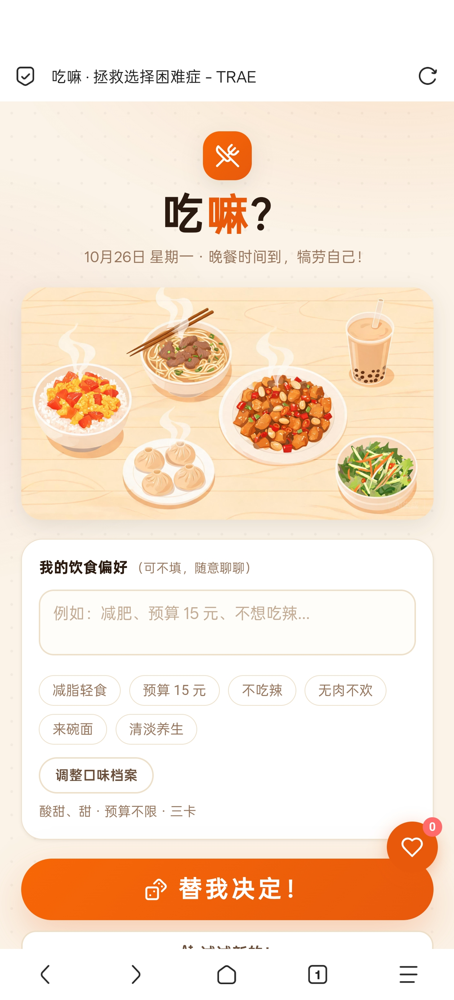
> 图 1　首页：一句话输入框与快捷偏好标签，首屏即可完成全部操作

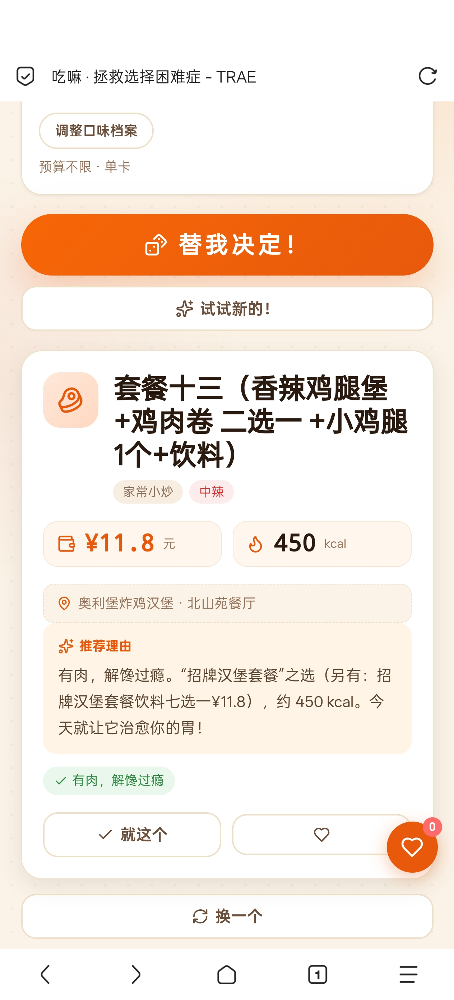
> 图 2　推荐结果卡片：价格、热量、档口与食堂位置、推荐理由与匹配标签

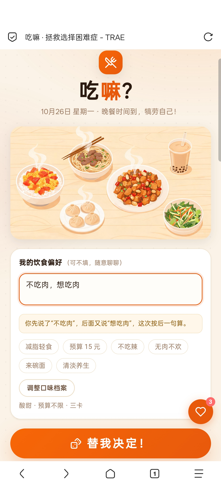
> 图 3　冲突实时提示：输入过程中即提示前后矛盾，并说明裁决依据

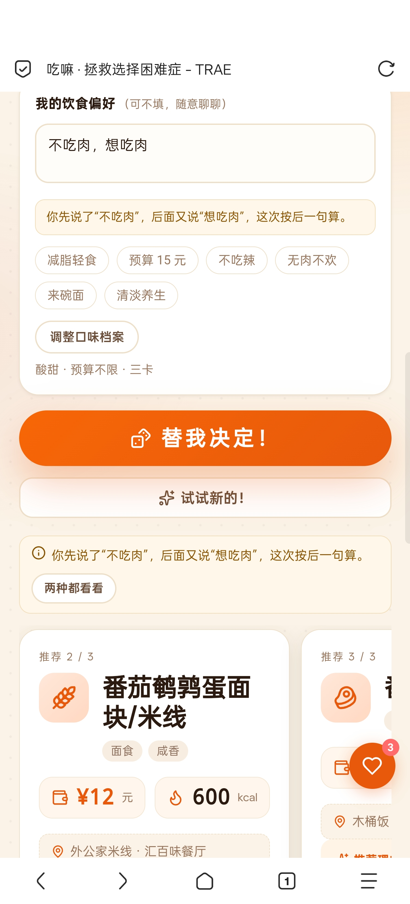
> 图 4　裁决结果与“两种都看看”入口：同时给出两种理解下的候选

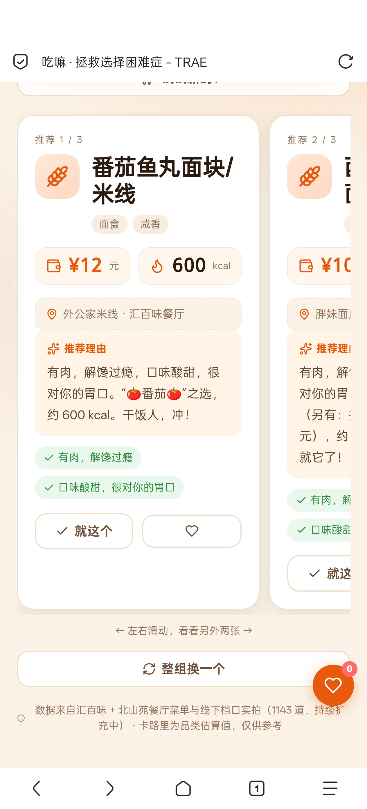
> 图 5　三卡横滑模式：一组内三个推荐来自不同档口

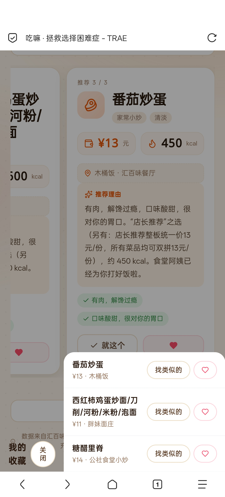
> 图 6　收藏夹：本地持久化保存，并提供“找类似的”入口

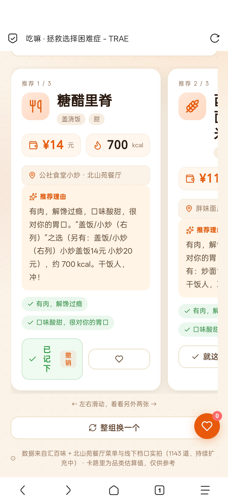
> 图 7　今天吃过：点“就这个”后显示“已记下 · 撤销”，5 秒内可撤销


> 图 8　口味档案：首次使用弹窗，可多选、可跳过，不做非黑即白选项

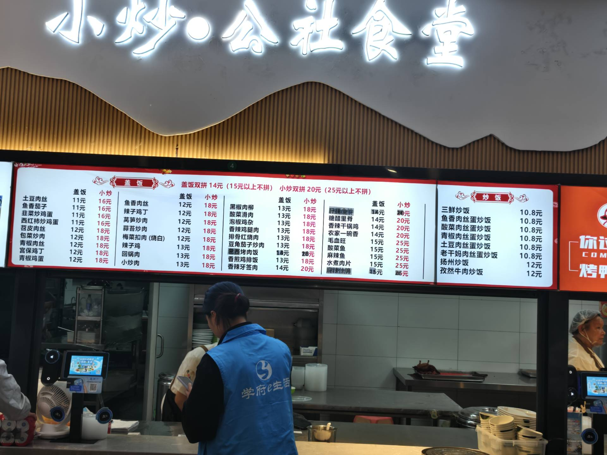
> 图 9　线下实拍：食堂档口菜单牌，为 OCR 结构化提供原始素材

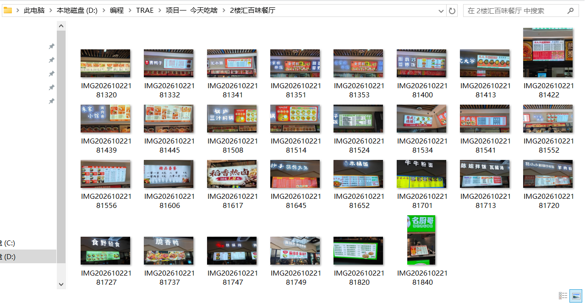
> 图 10　数据采集过程：按食堂与楼层分类归档的菜单照片（部分）

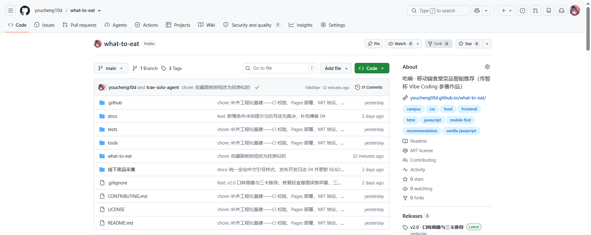
> 图 11　GitHub 仓库首页：About、Topics、提交记录与 Releases

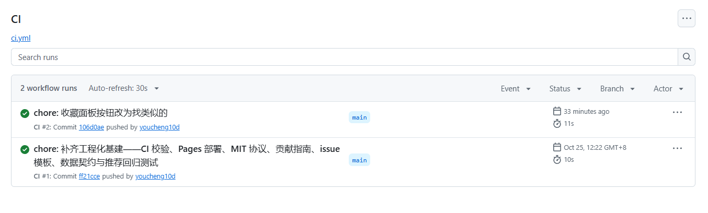
> 图 12　CI 自动化：每次提交自动执行语法检查、数据契约校验与回归测试

---

## 六、项目之前是否发表过或获奖

- **是否公开发表**：是。项目源码已在 GitHub 以 MIT 协议开源（github.com/youcheng10d/what-to-eat），并已通过 GitHub Pages 部署为可公开访问的在线版本，另有开发日志系列 4 篇记录完整演进过程。
- **是否获奖**：否。本项目为首次参加该项赛事，此前未参加其他赛事，也未获得过奖项。
- **是否对外发布过版本**：已在仓库发布 v1.0、v1.2、v2.0 三个 Release 版本，均带更新说明。

---

## 七、是否在其他项目基础上优化

**本项目不是在其他项目基础上优化的作品**，从 v0.1 起即为独立开发，无第三方代码基座，未使用他人开源项目作为起点（仅使用原生 JavaScript 与系统 API，无框架依赖）。

需要说明的是，项目自身经历了多轮迭代，v2.0 是在自身 v1.2 基础上的优化版本，主要优化部分如下：

| 维度 | v1.2 | v2.0 优化 |
| --- | --- | --- |
| 推荐依据 | 规则权重来自开发者个人经验 | 依据 24 份真实问卷结论校准软打分权重 |
| 口味偏好 | 无用户画像 | 首次使用口味档案，本地存储，不做非黑即白选项 |
| 反馈机制 | 无 | “就这个”只做正向记录，不惩罚“换一个” |
| 结果呈现 | 单卡 | 单卡与三卡横滑，一组内强制不同档口 |
| 档口分布 | 无限制 | 档口滑窗限频，避免连续推荐同一家 |
| 冲突输入 | 直接按后写覆盖，用户无感知 | 实时提示 + 后写优先裁决 + 两种都看看 |
| 数据规模 | 1055 道 / 47 档口 | 1143 道 / 49 档口 |
| 工程化 | 无自动化 | CI 回归测试 + Pages 自动部署 + MIT 协议 |

---

## 附：版本演进

| 版本 | 内容 | 状态 |
| --- | --- | --- |
| v0.1 | 纯前端 MVP，50 道模拟菜品 | 已发布 |
| v1.0 | 接入“学府 e 生活”小程序接口，345 道真实菜品 | 已发布 |
| v1.1 | 线下逐档口拍照 OCR 录入 | 已发布 |
| v1.2 | 剔除商业街、推荐引擎重写，1055 道 / 47 档口 | 已发布 |
| v2.0 | 口味档案、正反馈、单卡与三卡、档口滑窗、冲突处理、收藏与今天吃过，1143 道 / 49 档口 | 已发布 |

## 附：目录结构

```
项目一  今天吃啥/
├── README.md
├── LICENSE
├── docs/                      # 开发日志、接口侦察记录、作品介绍文档
├── tests/recommend.test.mjs   # 推荐引擎回归测试
├── tools/                     # 数据采集、清洗、合并、校验脚本
└── what-to-eat/               # 应用本体（index.html / styles.css / app.js / api.js / mock.js / data）
```
